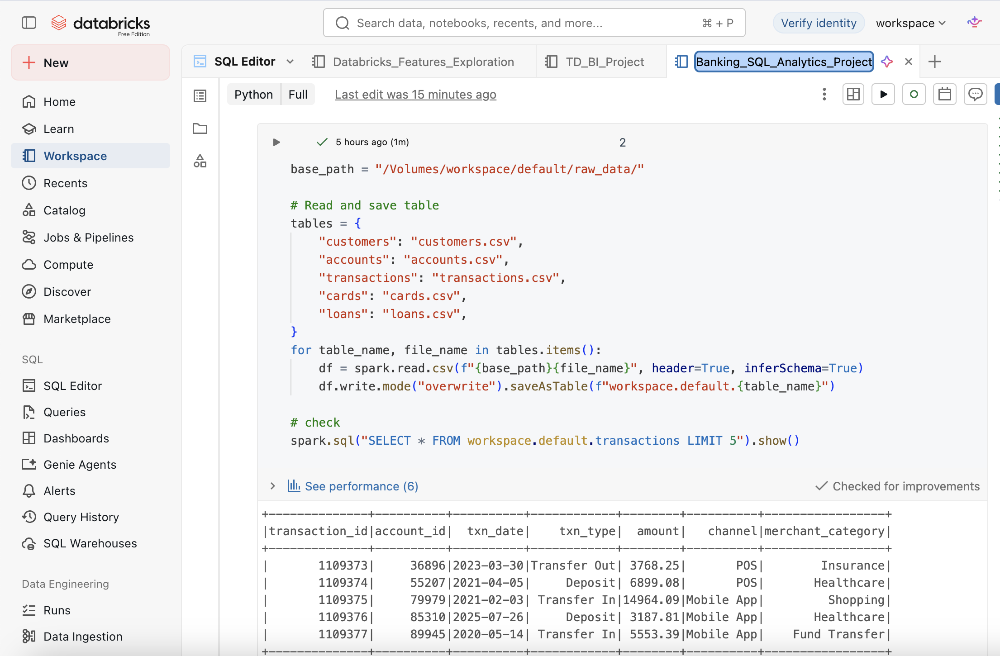
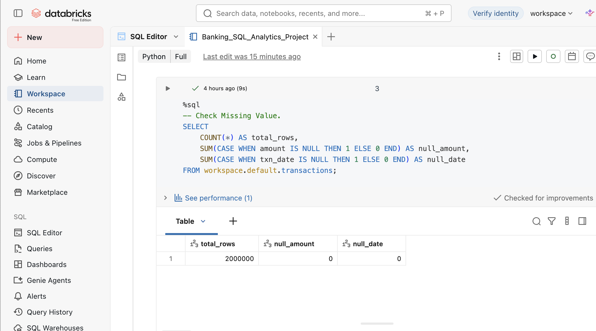
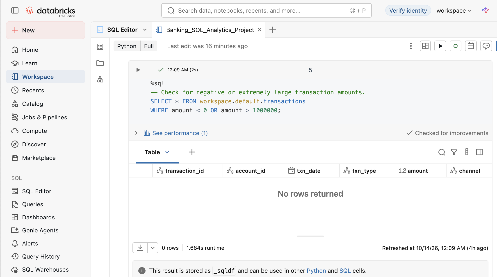
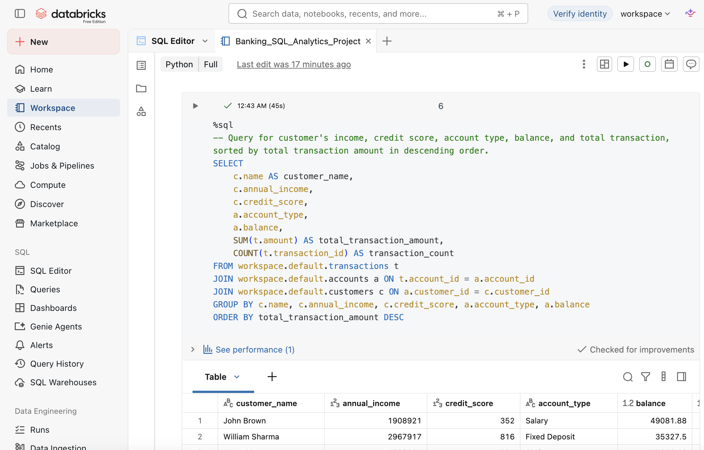
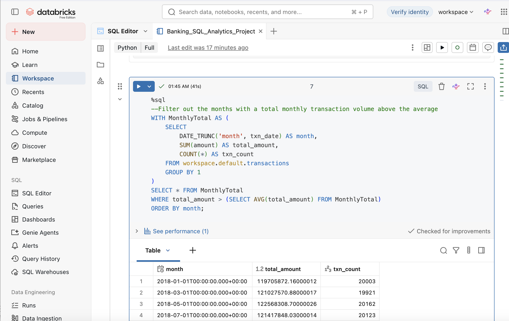
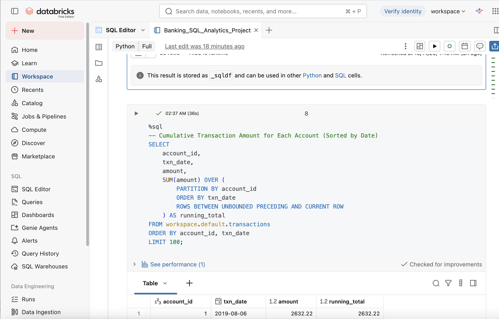
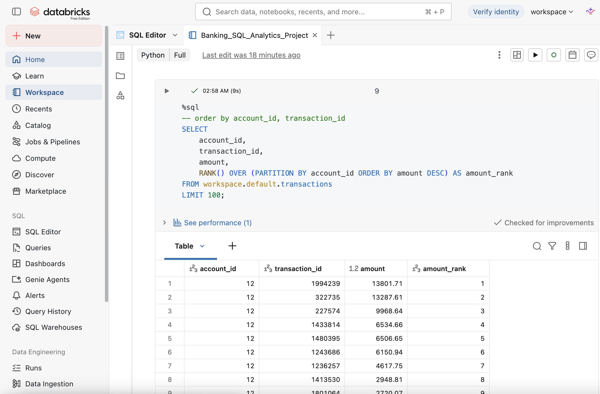
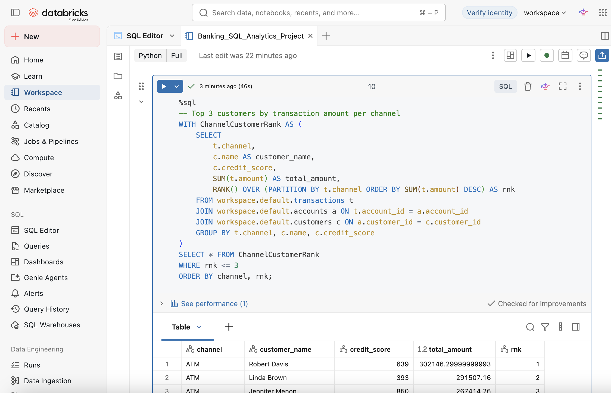

# Databricks-Banking-Transactions-SQL-Analysis

## Data Source

- Kaggle: Banking Transactions Dataset
- Link: https://www.kaggle.com/datasets/vivekmali1436/banking-transactions-dataset
- Records: 2,000,000 transaction records
- Tables Used:
  - `customers`: Customer information, including annual income and credit score.
  - `accounts`: Bank account information, including account type and balance.
  - `transactions`: Transaction records, including amount, date, type, and channel.
  - `cards`: Customer card information.
  - `loans`: Customer loan information.

The CSV files were uploaded to a Databricks Unity Catalog Volume. PySpark was used to read the files and save them as tables for further SQL analysis.

## Tools

- Databricks Free Edition
- SQL
- Python (PySpark)
- Spark DataFrame
- Unity Catalog
- Delta Lake

## Analysis Process

1. Uploaded the raw CSV files to a Databricks Unity Catalog Volume.
2. Used PySpark to read the datasets and create tables in Databricks.
3. Performed data quality checks for missing values, duplicate transaction IDs, and unusual transaction amounts.
4. Used multi-table JOINs to combine customer, account, and transaction information.
5. Applied CTEs to analyze monthly transaction activity.
6. Used window functions to calculate cumulative transaction amounts and rank transactions.
7. Combined JOINs, CTEs, and window functions to identify top customer groups by transaction amount across different channels.

## Data Preparation

### Data Loading and Table Creation

Used PySpark to load five CSV files and save them as tables in Databricks for SQL analysis.

## Data Quality Checks

### Missing Value Check

Checked 2,000,000 transaction records for missing values in transaction amounts and dates. No missing values were found in either field.

### Duplicate Transaction Check

Checked for duplicate transaction IDs using `GROUP BY` and `HAVING`. No duplicate transaction IDs were found.

### Transaction Amount Range Check

Checked for negative transaction amounts and transactions exceeding 1,000,000. No transactions were found outside the specified range.

## SQL Analysis

### Multi-Table JOIN Analysis

Joined the `customers`, `accounts`, and `transactions` tables to analyze customer annual income, credit scores, account types, balances, total transaction amounts, and transaction counts.

### Monthly Transaction Analysis Using CTE

Used a CTE to calculate monthly transaction amounts and transaction counts. Identified months with total transaction amounts above the average monthly total.

## Window Function Analysis

### Cumulative Transaction Amount by Account

Used `SUM() OVER()` with `PARTITION BY` to calculate cumulative transaction amounts for each account, ordered by transaction date.

### Transaction Amount Ranking by Account

Used `RANK()` to rank transactions by amount within each account, helping identify the largest individual transactions.

### Top Customers by Transaction Amount per Channel

Combined multi-table JOINs, aggregation, CTEs, and `RANK()` to identify the top three customer groups by total transaction amount in each transaction channel and display their credit scores.

## Key Insights

1. **Data Quality:** The dataset contains 2,000,000 transaction records, with no missing transaction amounts or dates, duplicate transaction IDs, or amounts outside the specified range.

2. **Customer Transaction Analysis:** Multi-table JOINs allow customer income and credit scores to be analyzed alongside account balances and transaction activity.

3. **Monthly Transaction Activity:** CTE analysis identifies months with transaction totals above the overall monthly average.

4. **Account Transaction Patterns:** Window functions provide cumulative transaction amounts and rankings of individual transactions within each account.

5. **Channel Analysis:** Customer transaction rankings across different channels help identify groups with high transaction activity and provide their credit scores for further analysis.

## Business Recommendations

1. **High-Value Customer Identification:** Combine credit scores and total transaction amounts to identify high-value customers and recommend exclusive mobile banking investment services to customers with high credit scores.

2. **Transaction Trends:** Use months with above-average total transaction amounts to support marketing campaigns and improve customer engagement.

3. **Risk Monitoring:** Establish automated alerts for unusual transaction amounts, such as extremely large or negative transactions.
## Notebook File
Databricks notebook available in the `notebooks` folder.

## Author

- Name: Lingxi Li
- GitHub: lingxiquq-cpu
